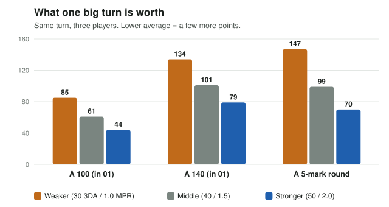
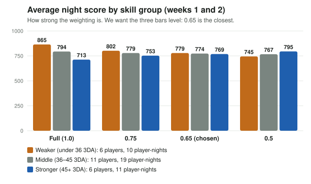

# Cheers Bar Card – Decisions and Discussion Items

Cheers Monday Doubles Dart League · Monday Mixed Doubles · Winter/Spring 2026/27
Bar Card: https://kzeitz.github.io/cheers-bar-card/ (v0.9.0 beta)

The Bar Card and the league Google Sheet follow the rules below. **Everything here is open to discussion.** The starting rules were chosen because they seemed obvious and straightforward, not because they are final. Final rulings belong to the league rules committee.

> **Please weigh in before Monday, Nov 30.** Any handicap changes need to be decided before that night so every match is played under the same rules. Send your questions or comments to Beth or Karlton.

_Last updated: 27 Nov 2026_

## Starting rules (all open to discussion)

| Topic | Rule |
|---|---|
| Cricket doubles (games 1, 2, 5, 9) | Each team's MPR = Player 1 + Player 2. The difference sets free marks: under 0.50 none, then 1 mark per 0.50, up to 5. Free marks count toward closing only. |
| 501 doubles (games 3, 7) | Each team's average 3DA = (Player 1 + Player 2) ÷ 2. The difference sets the spot: under 3.0 none, then 25 points per 3.0, up to 175. The lower team starts at 501 minus the spot. |
| 501 singles (games 4, 6, 8, 10) | Lower player starts at 501 × (lower 3DA ÷ higher 3DA), rounded. Higher player starts at 501. Per the DartConnect worksheet. |
| 701 doubles (game 11) | Scratch. |
| Stats used | 3DA from every 01 leg (singles 501, doubles 501, doubles 701). MPR from doubles cricket. Free handicap marks are not counted. Currently based on the **first two weeks of play** (stats through Nov 23). |
| New players and subs | A player with no league stats needs a 3DA (10–100) and MPR (0.10–6.00) entered before handicaps are shown. |
| Throwing order | Home team has the first 'option'; the loser of the prior leg has the 'option' thereafter. 'Option' = the choice of who corks first; closest to the bull throws first; on a tie, cork again in the reverse order. |
| Makeups | A makeup match uses the handicaps from the night it was scheduled. |
| Format | All 01 games are SISO (single in, single out). |
| Names | Full player names are shown on the Bar Card. |

## Open for discussion

**Our goal is fair matches, especially for the weaker players.** We want everyone to have fun, have a real chance in every game, and want to come back next season. Keep that in mind on every item below.

The items below are the ones we already know need a decision. Anything in the starting rules can be raised too.

### 1. Is the cricket marks chart too light?

**Today:** 1 free mark per 0.50 of combined MPR difference, up to 5.

**Example – strongest v weakest cricket pair (stats through Nov 23):**

| Team | Players' MPR | Combined |
|---|---|---|
| Diverted Flights | Josh Bieber 2.03 + Tammy Bieber 1.49 | 3.52 |
| Love at First Flight | Scott Mejeur 1.28 + Mary Mejeur 0.51 | 1.79 |
| | Difference | 1.73 → **3 free marks** |

These teams haven't played yet (they meet Dec 28 and Mar 22), so this is an estimate from their averages:
- Partners alternate turns, so Diverted Flights average about 1.76 marks a turn and Love at First Flight about 0.90.
- Diverted Flights need about 12 turns to close all 21 marks. In those 12 turns Love at First Flight score about 11 marks.
- **With no handicap**, the weaker team is about 10 marks short when the stronger team closes.
- **With the chart's 3 free marks**, they have about 14 of 21: still about 7 marks short.
- The same pairing in 501 gets a 125-point spot, about a quarter of the game. Three marks is about a seventh of a cricket game.

**Options:**
- **Keep the current chart:** in this example 3 free marks cut the gap from about 10 marks to about 7, but the weaker team is still well behind.
- **Double the rate:** `KZ thinks!` 1 mark per 0.25, up to 7. This pairing would get 6 marks, cutting the gap to about 4.
- Decide after a few weeks of results: the weekly audit will show how often teams receiving marks actually win cricket legs. But by then it may not be fair to change the chart mid-season, so any change would likely have to wait until the next league or season.

### 2. Which numbers do we use for each player?

**Today:** any league stats from this season count, even one night. A player with no league stats needs a 3DA and MPR entered, but there is no rule on where those numbers come from.

**Why it matters:** one night is a small sample. Tammy Bieber averaged 43.64 in week 1 and 33.12 in week 2. Samantha Cochran (sub) has one night: 5 legs of 01 and 4 of cricket.

Outside stats are also likely to be double-out (SIDO) averages, which run lower than the same player's SISO average. Used as is, the player looks weaker than they are and their team gets more help than it should. Once again the advantage goes to the stronger player.

**Suggested approach:** use the first source that applies.

1. **This season's league stats**, once the player has enough legs.
2. **Recent outside stats** (another league or an earlier season, from DartConnect or elsewhere). If they come from double-out play, use the player's First 9 average × about 0.95. The first nine darts come before any finishing, so the out rule barely affects them.
3. **No usable stats:** a fallback (choose one below).

**To decide:**

| Question | Options |
|---|---|
| Legs needed before league stats count | • Any • 9 (one night): in effect what's used today, since stats update after each full night `KZ thinks!` • 18 (two nights) • Blend entered and league stats until the minimum |
| How old outside stats can be (DartConnect or elsewhere) | • Last 12 months • Last two seasons `KZ thinks!` • No limit • Other |
| SIDO to SISO stats conversion | • First 9 × ~0.95 `KZ thinks!` • Use as is • Flat adjustment |
| No usable stats at all | • Team's average for the night • League average (about 39.90 3DA / 1.35 MPR) `KZ thinks!` • Scratch for any game the new player is in: the new player or the new player's team receive no marks or spot. The opponents' handicap is calculated as if the new player were a league average player. No stats needed for the new player. • Captains agree at the board, or the league director decides `KZ thinks! In the spirit of fairness, the league director can always override the numbers. Especially useful when Luke Littler subs for someone!` |

### 3. Player of the Week and season standings

> **Heads up: this is probably the most debatable part of the whole document.** There is no established way to rank players of very different skill levels against each other in a handicapped dart league, so we are rolling our own. What follows is our best attempt to use sound, simple math so that anyone, at any level, can win Player of the Week, and nobody feels the system is stacked for or against them. Every number here can be tuned.

**What we borrowed from**

- **Bowling handicaps.** Bowling leagues have done this for decades: a bowler's handicap is a percentage (often 80–100%) of the gap between a set score and their own average, so players of all levels can compete for the same prizes. ([BowlingBall.com](https://bowlingball.com/BowlVersity/how-to-calculate-bowling-handicap), [BowlerSmart](https://www.bowlersmart.com/2021/05/04/how-handicap-makes-league-bowling-fun-fair-equal-for-all-bowlers))
- **Dart league ratings.** Handicapped dart leagues rate each player from their own 3-dart average and MPR, and update the rating as the season goes. ([DartsTOC league rules](https://dartstoc.com/rwdtoc/2020RemoteLeague2.pdf), [VCDA](https://vcda.org/calculation.php))
- **Beating your own normal.** A common way to compare people of different abilities: measure each performance against what that person usually does, not against everyone else.

**The idea in one sentence:** every turn that beats your own average earns points. The bigger the turn, the more points, and the same turn is worth a bit more from a player whose average is lower.

#### How one turn is scored

1. **Start with your own average turn.** In 01 that is your 3-dart average (3DA). In cricket it is your average marks per turn, counted with the bull rule below (so it can differ slightly from DartConnect's MPR).
2. **Count only what's above it.** A 40-average player who throws 100 is 60 above their average. A turn at or below your average scores zero. No penalty, just no points.
3. **Apply the weighting.** The amount above your average is multiplied by a weighting based on how your average compares with the league average (about 40.7 in 01 and 1.52 marks in cricket). A lower average gives a weighting a little above 1, and a higher average a little below 1. The weighting is deliberately gentle (we use 0.65 strength, explained below), so it nudges rather than flips the result.
4. **Cricket marks are converted to points: 1 mark = 19 points.** We picked 19 so that cricket and 01 count about equally per turn thrown. Cricket is about 47% of all turns and earns about 51% of the points. It also matches how often big turns happen: in weeks 1 and 2 a 5-mark round and a 100+ turn each came up in about 3% of turns, so they are worth about the same.

**Bulls.** On the board, the double bull is about half the size of a treble 20, and the single bull is about a sixth the size of a single 20, yet DartConnect counts them as only 2 marks and 1 mark. For Player of the Week only (the game itself doesn't change), bulls count like this:

| Dart | Size on the board | DartConnect marks | Player of the Week marks |
|---|---|---|---|
| Single 20 | about 3,800 mm² | 1 | 1 |
| Single bull | about 670 mm² | 1 | **2** (like a double) |
| Treble 20 | about 260 mm² | 3 | 3 |
| Double bull | about 130 mm² | 2 | **3** (like a treble) |

So six bulls (three double bulls) counts as 9 marks, the same as three treble 20s, and a bull dart is never worth less than the matching 20 dart. Because each player's cricket average is counted the same way, the bull rule doesn't tilt the scores toward cricket or toward bull-heavy players.

| Turn | Weaker player (30 3DA / 1.0 marks) | Middle player (40 3DA / 1.5 marks) | Stronger player (50 3DA / 2.0 marks) |
|---|---|---|---|
| 60 | 37 | 20 | 9 |
| 100 | 85 | 61 | 44 |
| 140 | 134 | 101 | 79 |
| 180 | 183 | 142 | 114 |
| 4 marks | 75 | 48 | 32 |
| 5 marks | 100 | 67 | 48 |
| 7 marks | 149 | 105 | 79 |
| 9 marks, or 6 bulls | 199 | 143 | 111 |

What each factor does:
- **"Above your own average"** means a 60 is a great turn for a 30-average player but routine for a 50-average player, and the points reflect that.
- **The weighting** gives a weaker player's big turn some extra credit, but a strong player's 180 is still one of the biggest scores of the night.
- **The cricket conversion** puts 01 and cricket on the same scale: a 5-mark round is worth about a 100, and a 9-mark round about a 180.
- **The bull rule** makes bulls worth at least as much as 20s.

#### How a night is scored

- Add up the points from all your turns that night.
- **Divide by the number of turns you threw, then multiply by 80** (a typical night). Weaker teams' legs run longer, so their players throw more turns (90–112 a night in weeks 1 and 2, against 61–91 for stronger players). Scoring per turn means more turns don't mean more chances.
- **Highest night score wins Player of the Week.**

**Which average is used:** your average from the weeks before that night, so a hot night doesn't lower its own score. In week 1, or a player's first night, there is nothing earlier, so that night's own stats are used. Averages below 25 in 01 or 0.80 marks in cricket are treated as 25 and 0.80, so one very low average can't produce huge points.

#### How we checked it's fair

We scored weeks 1 and 2 (about 3,300 turns) under different weighting strengths and compared the average night score of weaker, middle and stronger players. If the system is fair, the three bars should be about level.

- **Full weighting (1.0)** tilted toward weaker players by about 20%.
- **Less weighting (0.5)** starts tilting toward stronger players, because a 50 player's good turns are bigger numbers to begin with.
- **0.65** puts the three groups within 11 points of each other (778 / 773 / 767), far less than the normal night-to-night swing of any one player (about 200 points).

Things we tried and dropped:
- **Fixed bars (60+ in 01, 4+ marks in cricket).** Easy for a 50 player and rare for a 30 player, so stronger players dominated.
- **A bar of "1.5× your own average".** Cricket marks come in whole numbers, so the bar jumped at certain averages (1.28 MPR needed 2 marks, 1.34 needed 3). Counting points above your average has no jumps.
- **30 points per mark.** Cricket earned about 61% of all points, and a 5-mark round was worth far more than a 100 even though both happen about as often.

#### Season standings

- **Your standing is the average of your best N nights,** where **N = half your team's nights so far, rounded up.** Byes don't count.
- Rankings start in week 1.
- **Showing up never hurts you.** Every extra night is another chance at a good one, and an off night just doesn't get counted.
- **Missing nights costs a little.** If you've played exactly N nights, all of them count, including the off ones.

| End of season (20 team nights, N = 10) | Nights counted |
|---|---|
| Played all 20 | best 10 of 20 |
| Played 14 | best 10 of 14 |
| Played 10 | all 10, good and bad |
| Played 8 | not ranked yet (needs 10) |

Early in the season N is 1, so the standings are just "best night so far". They become meaningful around week 4, when N becomes 2.

#### Weeks 1 and 2 under these rules

**Week 1 (Nov 16): Player of the Week is April Lapthorne (951)**

| # | Player | 3DA / cricket marks used | Night score | Best turn |
|---|---|---|---|---|
| 1 | April Lapthorne | 41.3 / 1.59 | 951 | 129 |
| 2 | Keyra Jallah | 31.3 / 1.05 | 891 | 4 marks |
| 3 | Julie Dirks | 39.5 / 1.52 | 850 | 121 |
| 4 | Sierra Rensch | 41.7 / 1.47 | 844 | 120 |
| 5 | Lynette Baluja | 36.9 / 0.87 | 837 | 6 marks |

**Week 2 (Nov 23): Player of the Week is Karlton Zeitz (1,082)**

| # | Player | 3DA / cricket marks used | Night score | Best turn |
|---|---|---|---|---|
| 1 | Karlton Zeitz | 48.5 / 1.65 | 1,082 | two 6-mark rounds |
| 2 | Sierra Rensch | 41.7 / 1.47 | 1,061 | 5 marks; outs of 80 and 63 |
| 3 | Joe Chavez | 38.2 / 1.23 | 1,033 | 105 |
| 4 | Scott Mejeur | 34.6 / 1.31 | 1,026 | three 5-mark rounds |
| 5 | Keyra Jallah | 31.3 / 1.05 | 922 | 89 |

**Standings after week 2** (N = 1, so best night so far): 1. Karlton Zeitz 1,082 · 2. Sierra Rensch 1,061 · 3. Joe Chavez 1,033 · 4. Scott Mejeur 1,026 · 5. April Lapthorne 951.

**Highlights.** Big turns always earn points; these are just the ones worth a shout-out.
- **Week 1:** Larry Shattuck had a 7-mark round, a 6-mark round and three 5-mark rounds, plus a 140. Jacob Shaw, Josh Bieber and Tammy Bieber each had a 7-mark round. Kristen Rosenbach threw a 140 and a 135, and Karlton Zeitz a 140.
- **Week 2:** Josh Bieber and Matthew Meyer each threw a 180. Karlton Zeitz had two 6-mark rounds, and Shadd Cordrey threw a 140.

#### Keeping it honest

- **A weekly fairness check** (average night score for weaker, middle and stronger players, season to date) will be published with the standings.
- **If any group drifts more than about 5% from the others for 4 or more weeks,** we re-tune the weighting and say so.
- **Each player can see their own numbers:** the averages used and what each of their turns earned.

**To decide:**

| Question | Options |
|---|---|
| Weighting strength | • 0.65 (tested as the most even) • Something else after more weeks of data |
| Bull value | • Single bull 2, double bull 3 (as above) • Double bull 4, closer to its size on the board |
| Bonus for big checkouts | • No bonus (the turn already earns points) • Extra points for outs of 100 or more |
| Standings minimum | • Half your team's nights, rounded up • A fixed number of nights |

## Captain announcement (draft)

> **Subject: New handicap Bar Card – starting Monday**
>
> Hi captains,
>
> Starting Monday (Nov 30), get your handicaps on your phone:
> **https://kzeitz.github.io/cheers-bar-card/** (or scan the QR code at the bar)
>
> 1. Pick tonight's matchup. It's already filled in from the schedule.
> 2. Check your lineup. Captain is Player 1 by default; change it or pick a sub if needed.
> 3. Read your cricket marks, 501 doubles start and singles starts. Tap "How it's calculated" to see the math.
>
> Stats come from DartConnect and are updated weekly; the date is shown at the top. New player or sub with no league stats? Pick "New player…" and enter their 3DA and MPR. The card shows full player names.
>
> It's a beta (v0.9.0), so let me know if anything looks off.
>
> Thanks,
> Beth

## Week 2 audit (Nov 23)

After each night we compare the handicaps actually entered in DartConnect with what the Bar Card rules give. Week 2 was worked out by hand, before the Bar Card existed, and it didn't go well:

| Game type | Correct | Different | Can't check |
|---|---|---|---|
| Cricket doubles | 8 | 4 | 8 |
| 501 doubles | 6 | 0 | 4 |
| 501 singles | **0** | **14** | 6 |
| 701 doubles (scratch) | 3 | 0 | 2 |
| **Total** | **17** | **18** | **20** |

- **Singles:** every checkable singles game was different. A 25-point spot chart was used instead of the worksheet's 501 × (lower ÷ higher 3DA). Details below.
- **Cricket:** 2 Nips 1 Tip received 3 free marks in all four cricket games against Total Bulls Hit, where the chart gives none. Diverted Flights v One Hit Wonders was correct (2 marks).
- **501 doubles:** all correct.
- **Can't check:** Savages Vol 2 had a bye in week 1 and Samantha Cochran was new, so there were no league stats for games involving them.

**How far off were the singles?** Not by much in any one game, but always in the same direction: **in all 14 games the weaker player started higher than the worksheet gives**, so they got less help than they should have.

- Average: **17 points** of help missed per game; range 2 to 29.
- 4 games were within 10 points; 6 were off by 20 or more.
- 17 points is about half a turn for a typical player here. It's small in one game, but it always went against the weaker player.

| Match (lower player in **bold**) | Played at | Worksheet | Help missed |
|---|---|---|---|
| **Shadd Cordrey** v Matthew Meyer | 401 | 376 | 25 |
| **Sierra Rensch** v April Lapthorne | 501 | 496 | 5 |
| **Shadd Cordrey** v April Lapthorne | 501 | 472 | 29 |
| **Sierra Rensch** v Matthew Meyer | 426 | 403 | 23 |
| **Mary Mejeur** v Larry Shattuck | 326 | 305 | 21 |
| **Scott Mejeur** v Larry Shattuck | 401 | 382 | 19 |
| Lorrie Shaw v **Julie Dirks** | 451 | 445 | 6 |
| **Joe Chavez** v Karlton Zeitz | 401 | 395 | 6 |
| **Lorrie Shaw** v Karlton Zeitz | 476 | 459 | 17 |
| **Joe Chavez** v Julie Dirks | 501 | 484 | 17 |
| Josh Bieber v **Lynette Baluja** | 376 | 351 | 25 |
| **Tammy Bieber** v Jacob Shaw | 476 | 463 | 13 |
| Josh Bieber v **Jacob Shaw** | 476 | 449 | 27 |
| **Tammy Bieber** v Lynette Baluja | 426 | 424 | 2 |

This is the main reason for the Bar Card: the same rules, worked out the same way, for every match. Full game-by-game report: [reports/audit_2026-11-23.md](reports/audit_2026-11-23.md).
